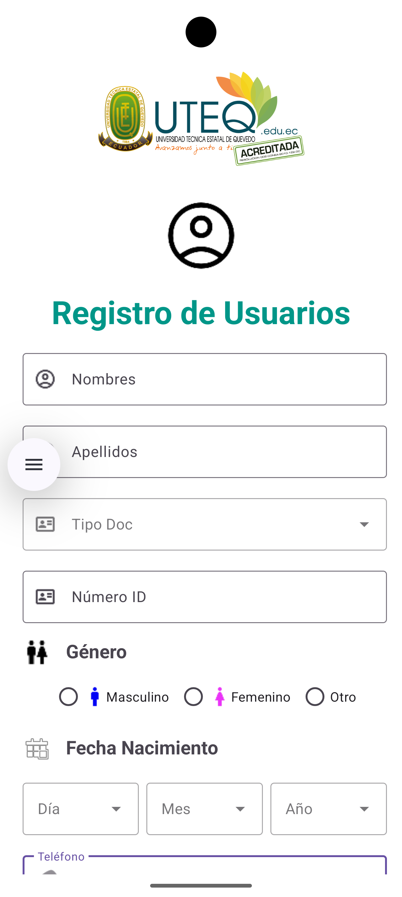

# Práctica 2: Registro de Usuarios (UTEQ)

App Android con una pantalla de **Registro de Usuarios** que sigue la identidad visual de la UTEQ.
Esta práctica es **solo de diseño**: el formulario se ve completo, pero el botón no guarda nada y los campos no se validan.

El diseño parte del repositorio de referencia [Practica2_UI_2026_IT](https://github.com/cristianzambrano/Practica2_UI_2026_IT). Se le agregó el logo UTEQ en la parte superior y se cambiaron los íconos de género.

## Captura

  

## Pantalla de Registro (`MainActivity` / `activity_main.xml`)
El contenido va dentro de un `ScrollView`, así que el formulario se desplaza en pantallas pequeñas.

| Sección | Componente | Detalle |
|---|---|---|
| Encabezado | `ImageView` | Logo UTEQ (`icon_principal.png`) y debajo el ícono de usuario (`user100.png`) |
| Título | `TextView` | "Registro de Usuarios", 34sp, negrita, color verde azulado `#009688` |
| Nombres / Apellidos | `TextInputLayout` outlined | Ícono `usuario.png` |
| Tipo Doc | Menú desplegable (`ExposedDropdownMenu`) | Opciones: Cédula, Pasaporte, RUC |
| Número ID | `TextInputLayout` outlined | Solo números, máximo 10 dígitos |
| Género | `RadioGroup` horizontal | Ícono `gender.png`; opciones Masculino (`men.png`), Femenino (`women.png`) y Otro |
| Fecha Nacimiento | 3 menús desplegables | Día (1–31), Mes (Enero–Diciembre), Año (1990–2020) |
| Teléfono | `TextInputLayout` outlined | Teclado telefónico |
| Acción | `Button` | **Grabar**, con ícono `guardar.png` y ancho completo |

Las opciones de los desplegables se cargan desde XML (`app:simpleItems` con los arreglos de `strings.xml`), sin código Java.

> Al final de la captura no se ve el botón **Grabar** porque hay que desplazar la pantalla para llegar a él.

## Archivos principales
| Archivo | Contenido |
|---|---|
| `app/src/main/res/layout/activity_main.xml` | Diseño del formulario |
| `app/src/main/res/values/strings.xml` | Arreglos `tipo_doc`, `dia`, `mes`, `anio` |
| `app/src/main/res/drawable/` | `icon_principal`, `user100`, `usuario`, `cedula`, `gender`, `men`, `women`, `guardar` |
| `app/src/main/java/.../MainActivity.java` | Solo carga el layout, sin lógica |

## Tecnologías
- Java 11, Android Gradle Plugin 9.5.1
- `minSdk` 24, `targetSdk` / `compileSdk` 37
- Material Components 1.14 (Material 3), ConstraintLayout

## Cómo ejecutarlo
1. Abre la carpeta `Practica_2_Registro` en Android Studio.
2. Espera a que termine la sincronización de Gradle.
3. Elige un emulador o dispositivo y presiona **Run ▶**.
